  

<h1 align="center">Ovra Browser</h1>

  A fast, private web browser for macOS, built on WebKit. 
  No accounts. No tracking. Just the web.

  
  
  

---

## Features

- **Ad and tracker blocking** built in, powered by DuckDuckGo's Tracker Radar
- **Fingerprinting resistance** to make you harder to follow across sites
- **Bookmarks and library**
- **Search and visit history**, with automatic deletion after a period you choose
- **Your choice of search engine**
- **Smart address bar** with suggestions
- **Themes**, including custom gradients
- **Automatic updates** through Sparkle

## Install

Download the latest `Ovra.pkg` from [Releases](https://github.com/OvraBrowser/Ovra/releases/latest), open it and follow the installer.

> The `.zip` attached to each release is used by the auto-updater. You don't need to open it.

## Build from source

1. Open `Ovra.xcodeproj` in Xcode 16 or later.
2. Select your development team under **Signing & Capabilities**.
3. Choose the **Ovra** scheme and press **Run**.

Swift packages resolve automatically. The blocking rules live in [`Packages/ContentBlockRuleList`](Packages/ContentBlockRuleList).

## Roadmap

- Ovra for iPhone and iPad, with iCloud sync for tabs, bookmarks and history
- Password manager and passkeys
- Privacy dashboard: trackers blocked, fingerprinting status, per-site permissions
- Tab groups, pinned tabs and tab search
- Reader mode and better PDF handling
- Faster startup and lower memory use
- Keyboard navigation, VoiceOver and reduced-motion polish

## Feedback

Found a bug or have an idea? [Open an issue](https://github.com/OvraBrowser/Ovra/issues).

## Credits

- Tracker blocklist from DuckDuckGo's [Tracker Radar](https://github.com/duckduckgo/tracker-radar), used under [CC BY-NC-SA 4.0](Packages/ContentBlockRuleList/LICENSE)
- [Sparkle](https://github.com/sparkle-project/Sparkle) for updates
- [ASN1Decoder](https://github.com/filom/ASN1Decoder) for certificate details

---

Made by <a href="https://kilianbalaguer.me">Kilian Balaguer</a> in Marrakech.

